

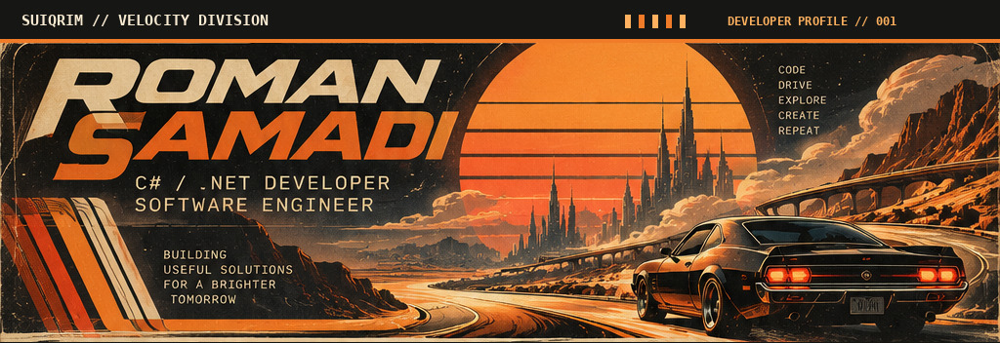


<table>
<tr>
<td width="33%"><a href="#обо-мне">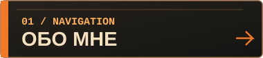</a></td>
<td width="33%"><a href="#стек">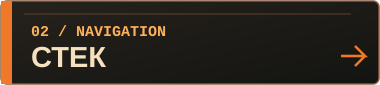</a></td>
<td width="33%"><a href="#проекты">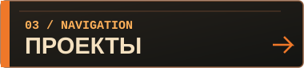</a></td>
</tr>
<tr>
<td width="33%"><a href="#вне-кода">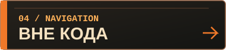</a></td>
<td width="33%"><a href="#github-телеметрия">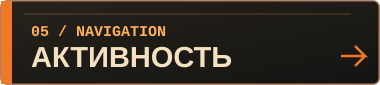</a></td>
<td width="33%"><a href="#контакты">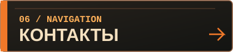</a></td>
</tr>
</table>



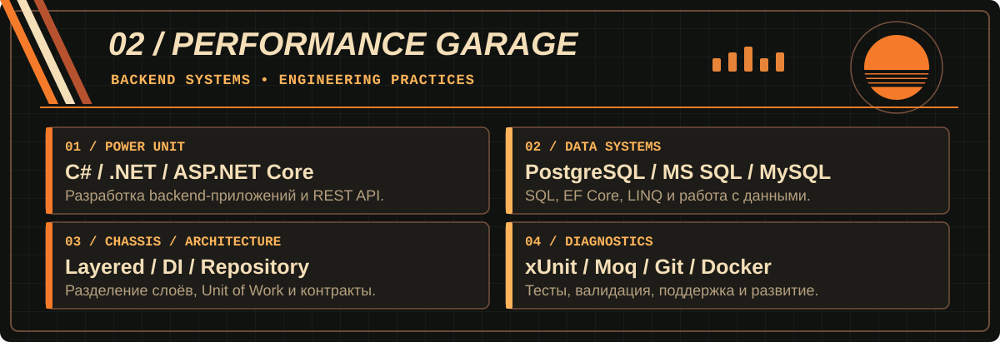

<!-- Принципы Engineering Rules удалены в обновленной иллюстрации ниже -->


<a href="https://github.com/SuiQRim/BillOfSaleSolution"></a>

<a href="https://github.com/SuiQRim/BillOfSaleSolution">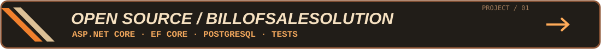</a>

<a href="https://github.com/SuiQRim/Journey"></a>

<a href="https://github.com/SuiQRim/Journey">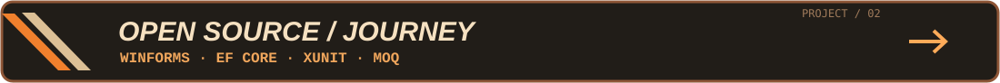</a>

<a href="https://github.com/SuiQRim/Cafeteria.API">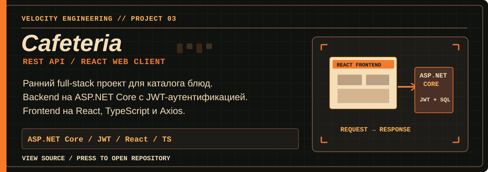</a>

<table>
<tr>
<td width="50%"><a href="https://github.com/SuiQRim/Cafeteria.API">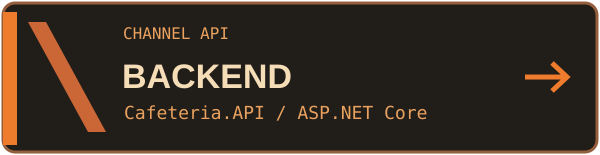</a></td>
<td width="50%"><a href="https://github.com/SuiQRim/cafeteria_website">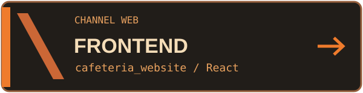</a></td>
</tr>
</table>

<a href="https://github.com/SuiQRim/SnakeGame">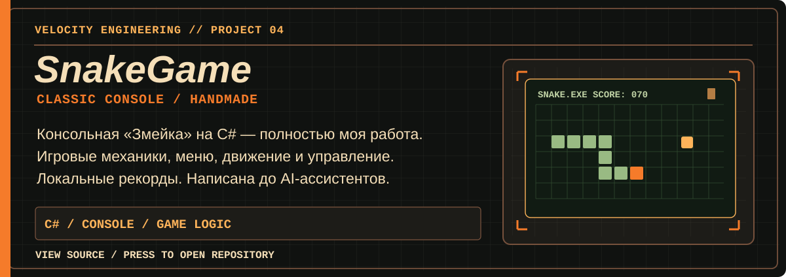</a>

<a href="https://github.com/SuiQRim/SnakeGame">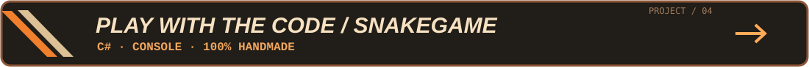</a>


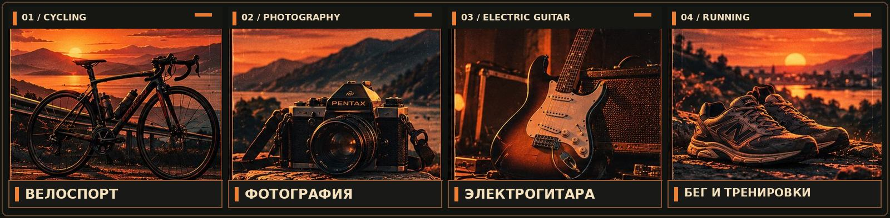


<table>
<tr>
<td width="33%"><a href="mailto:samadio.roman@gmail.com">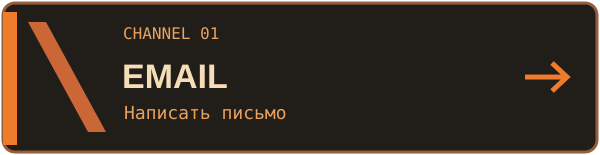</a></td>
<td width="33%"><a href="https://t.me/suiqrim">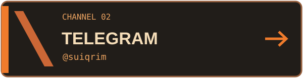</a></td>
<td width="33%"><a href="https://steamcommunity.com/id/SuiQRim/">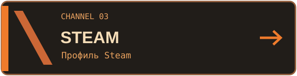</a></td>
</tr>
</table>
