<div align="center">



<table>
<tr>
<td width="33%"><a href="#обо-мне">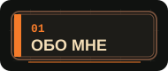</a></td>
<td width="33%"><a href="#стек">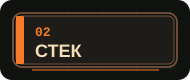</a></td>
<td width="33%"><a href="#проекты">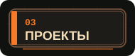</a></td>
</tr>
<tr>
<td width="33%"><a href="#вне-кода">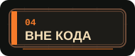</a></td>
<td width="33%"><a href="#github-телеметрия">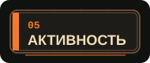</a></td>
<td width="33%"><a href="#контакты">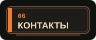</a></td>
</tr>
</table>


</div>

<a id="обо-мне"></a>

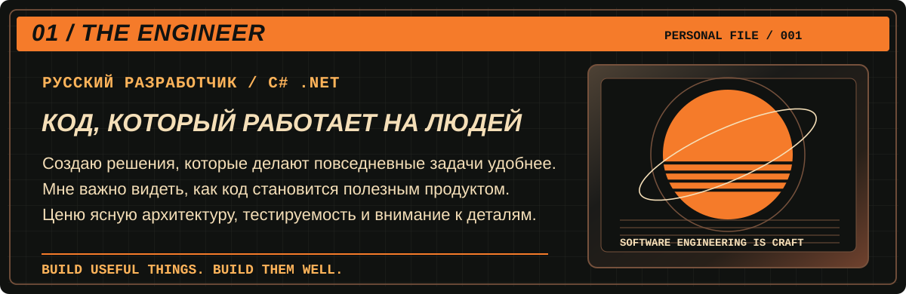

<a id="стек"></a>

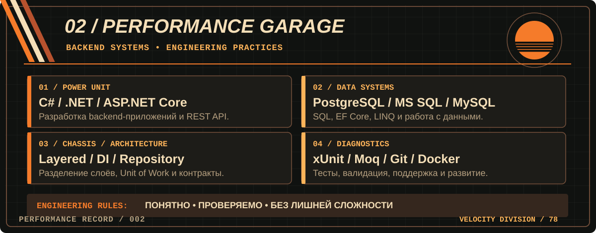

<a id="проекты"></a>


<a href="https://github.com/SuiQRim/BillOfSaleSolution">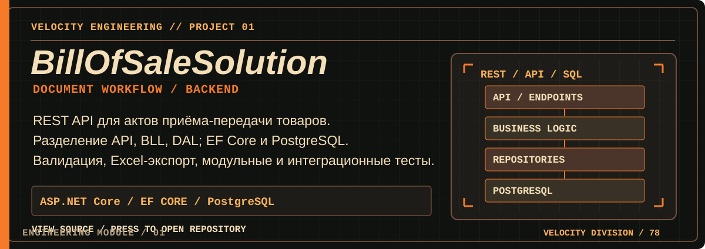</a>

<a href="https://github.com/SuiQRim/BillOfSaleSolution"></a>

<a href="https://github.com/SuiQRim/Journey">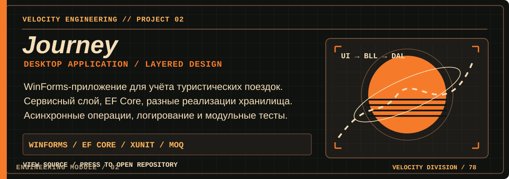</a>

<a href="https://github.com/SuiQRim/Journey"></a>

<a href="https://github.com/SuiQRim/Cafeteria.API">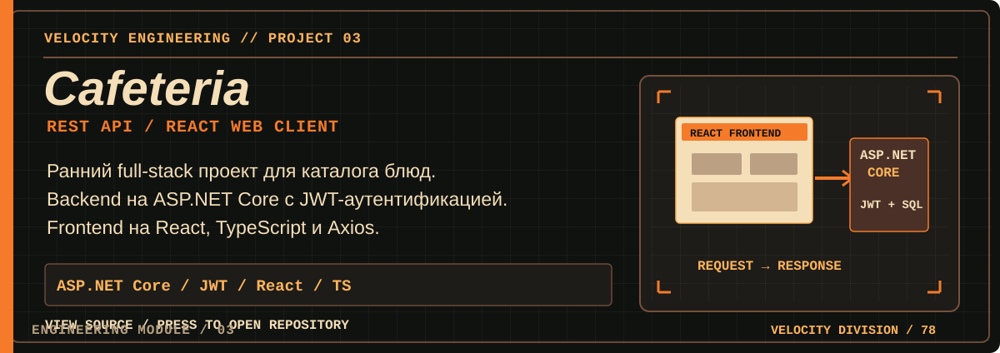</a>

<table>
<tr>
<td width="50%"><a href="https://github.com/SuiQRim/Cafeteria.API">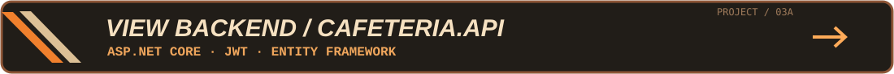</a></td>
<td width="50%"><a href="https://github.com/SuiQRim/cafeteria_website">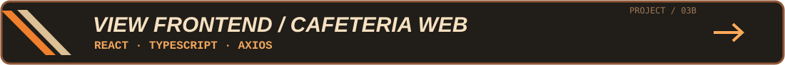</a></td>
</tr>
</table>

<a href="https://github.com/SuiQRim/SnakeGame">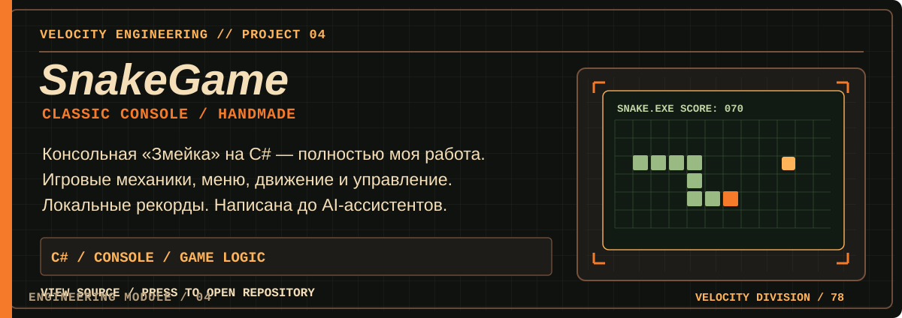</a>

<a href="https://github.com/SuiQRim/SnakeGame"></a>

<a id="вне-кода"></a>

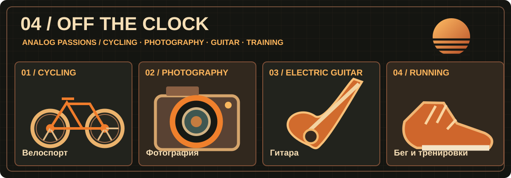

<details>
<summary><b>/// SECRET COMPARTMENT — личное дело пилота</b></summary>

```text
VELOCITY DIVISION // PERSONAL DATA
FAVORITE COLOR  : ORANGE
DESIGN DNA      : 1970s / RETRO FUTURE
FASCINATION     : MUSCLE CARS / ANALOG TECH
AFTER HOURS     : CYCLING / PHOTOGRAPHY
                  ELECTRIC GUITAR / TRAINING
SYSTEM STATUS   : KEEP EXPLORING
```

Мне близки эстетика 70-х, автомобильный дизайн и оптимистичное представление о будущем технологий.

</details>

<details>
<summary><b>/// SNAKE.EXE — секретный запуск</b></summary>

Мой старый проект, полностью написанный вручную до появления AI-ассистентов: [SnakeGame](https://github.com/SuiQRim/SnakeGame).

</details>

<a id="github-телеметрия"></a>

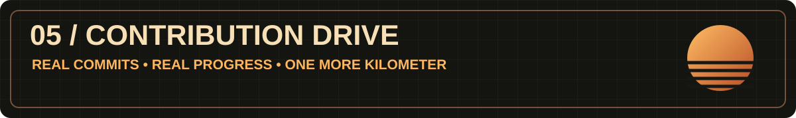

<div align="center">

</div>

<a id="контакты"></a>

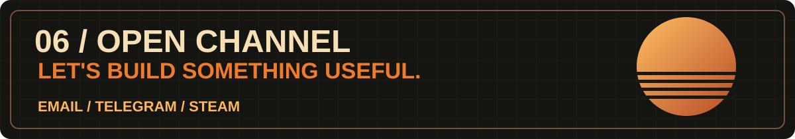

<table>
<tr>
<td width="33%"><a href="mailto:samadio.roman@gmail.com">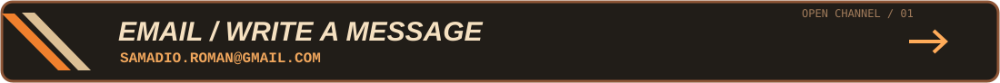</a></td>
<td width="33%"><a href="https://t.me/suiqrim">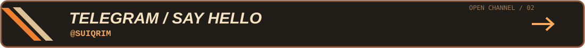</a></td>
<td width="33%"><a href="https://steamcommunity.com/id/SuiQRim/">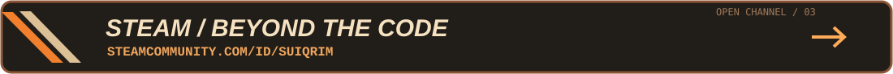</a></td>
</tr>
</table>
