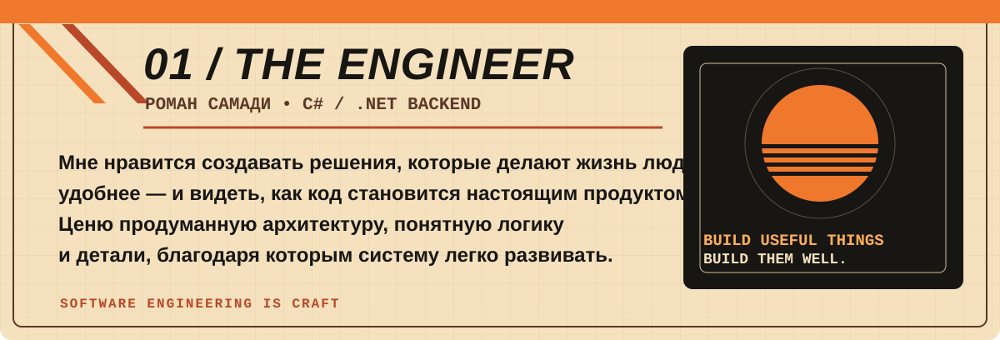
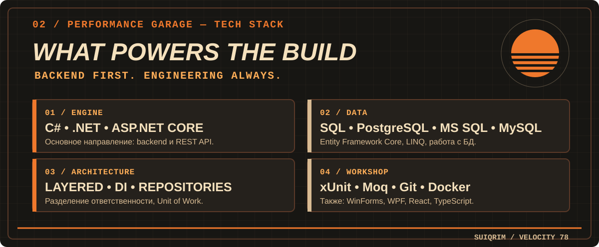
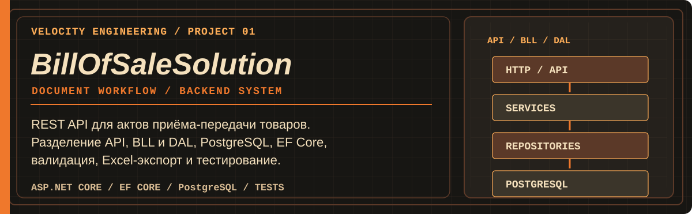
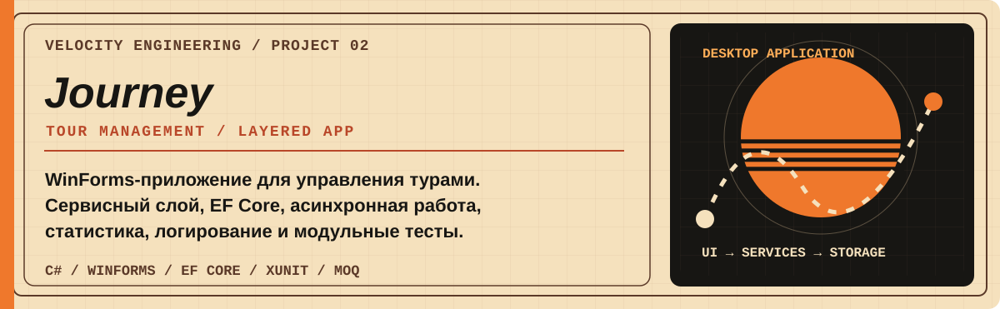
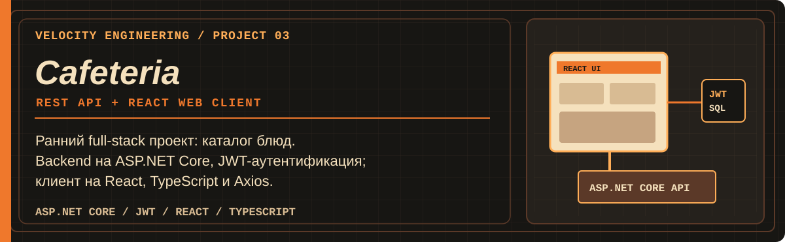
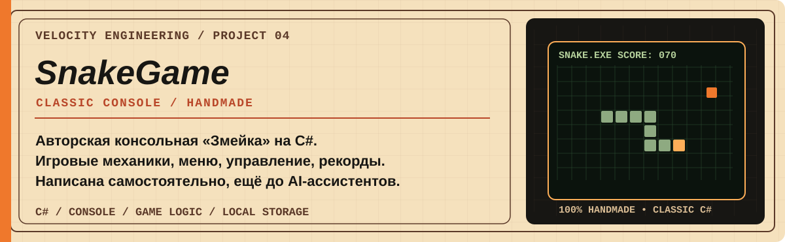
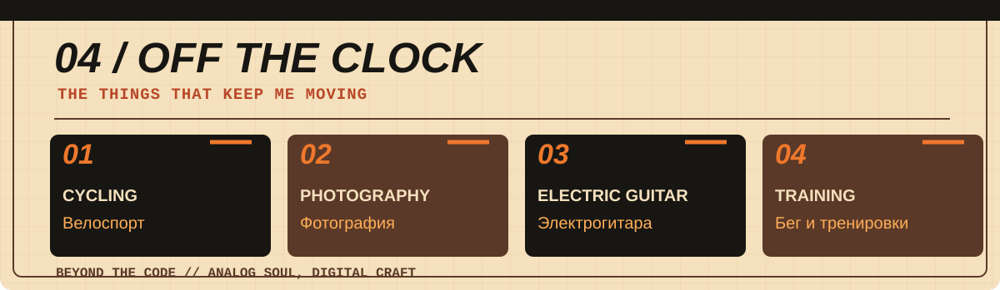
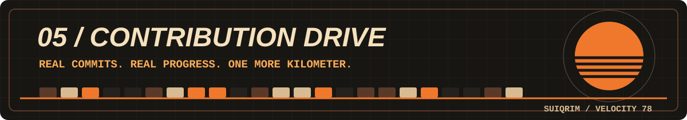
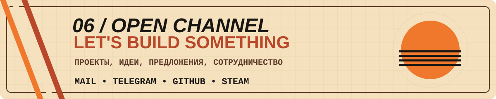

<div align="center">
  
</div>

<div align="center">
  <p><strong>C# / .NET DEVELOPER</strong> &nbsp;·&nbsp; SOFTWARE ENGINEER</p>
  <p><em>Создавать полезное. Проектировать с умом. Не останавливаться.</em></p>
  <p>
    <a href="#обо-мне">Обо мне</a> &nbsp; / &nbsp;
    <a href="#стек">Стек</a> &nbsp; / &nbsp;
    <a href="#проекты">Проекты</a> &nbsp; / &nbsp;
    <a href="#вне-кода">Вне кода</a> &nbsp; / &nbsp;
    <a href="#github-телеметрия">GitHub</a> &nbsp; / &nbsp;
    <a href="#контакты">Контакты</a>
  </p>
</div>

<div align="center">
  
</div>

<a id="обо-мне"></a>



<a id="стек"></a>



<details>
<summary><b>/// ENGINEERING NOTES — принципы разработки</b></summary>

- **Понятная архитектура:** разделение ответственности между компонентами системы.
- **Поддерживаемость:** предсказуемое поведение, ясные контракты и читаемый код.
- **Проверяемость:** валидация данных, тесты и обработка ошибок.
- **Разумная сложность:** технологии должны решать задачи продукта, а не становиться самоцелью.

</details>

<a id="проекты"></a>

<div align="center">


</div>

<a href="https://github.com/SuiQRim/BillOfSaleSolution"></a>

**[SOURCE / BillOfSaleSolution](https://github.com/SuiQRim/BillOfSaleSolution)** · `ASP.NET Core` `EF Core` `PostgreSQL` `Tests`

<a href="https://github.com/SuiQRim/Journey"></a>

**[SOURCE / Journey](https://github.com/SuiQRim/Journey)** · `C#` `WinForms` `EF Core` `xUnit`

<a href="https://github.com/SuiQRim/Cafeteria.API"></a>

**[BACKEND / Cafeteria.API](https://github.com/SuiQRim/Cafeteria.API)** &nbsp; / &nbsp; **[FRONTEND / cafeteria_website](https://github.com/SuiQRim/cafeteria_website)**

<a href="https://github.com/SuiQRim/SnakeGame"></a>

**[SOURCE / SnakeGame](https://github.com/SuiQRim/SnakeGame)** · `C#` `Console` `Game Logic`

<details>
<summary><b>/// PROJECT ARCHIVE — от первой игры до архитектурного backend</b></summary>

Каждый проект показывает отдельный этап моего развития: самостоятельная консольная игра, desktop-приложение с сервисным слоем, ранний full-stack и работа с более сложной архитектурой и тестированием.

[Посмотреть все репозитории](https://github.com/SuiQRim?tab=repositories)

</details>

<a id="вне-кода"></a>



<details>
<summary><b>/// SECRET COMPARTMENT — личное дело пилота</b></summary>
<br />

```text
VELOCITY DIVISION // PERSONAL DATA
─────────────────────────────────────
FAVORITE COLOR  : ORANGE
DESIGN DNA      : 1970s / RETRO FUTURE
FASCINATION     : MUSCLE CARS / ANALOG TECH
AFTER HOURS     : CYCLING / PHOTOGRAPHY
                  ELECTRIC GUITAR / TRAINING
SYSTEM STATUS   : KEEP EXPLORING
```

Мне нравится эстетика 70-х: американские маслкары, расклёшенные брюки, тёплые оттенки и тот особенный оптимизм, с которым тогда представляли будущее технологий.

</details>

<details>
<summary><b>/// SNAKE.EXE — скрытый запуск</b></summary>
<br />

```text
┌──────────────────────────────────────┐
│   SNAKE.EXE                1 PLAYER  │
│                                      │
│  ██ ██ ██ ●                  ◆       │
│                                      │
│  SCORE: 00070       MODE: CLASSIC    │
└──────────────────────────────────────┘
```

[Открыть исходники моей консольной змейки](https://github.com/SuiQRim/SnakeGame)

</details>

<a id="github-телеметрия"></a>



<div align="center">

**[REPOSITORIES](https://github.com/SuiQRim?tab=repositories)** &nbsp; / &nbsp; **[CONTRIBUTION GRAPH](https://github.com/SuiQRim)**


</div>

<details>
<summary><b>/// SYSTEM INFO — как работает змейка?</b></summary>

Змейка строится из реальных вкладов GitHub с помощью GitHub Actions и публикуется в отдельной ветке `output`.

</details>

<a id="контакты"></a>


<div align="center">

**[EMAIL](mailto:samadio.roman@gmail.com)** &nbsp; / &nbsp; **[TELEGRAM](https://t.me/suiqrim)** &nbsp; / &nbsp; **[GITHUB](https://github.com/SuiQRim)** &nbsp; / &nbsp; **[STEAM](https://steamcommunity.com/id/SuiQRim/)**

*Открыт к интересным задачам, новым технологиям и профессиональному общению.*

</div>
