


<a href="#обо-мне">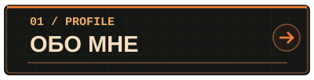</a>
<a href="#стек">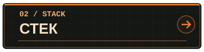</a>
<a href="#проекты">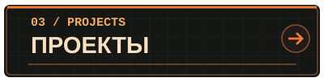</a>
 
<a href="#вне-кода">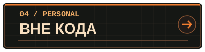</a>
<a href="#github-телеметрия">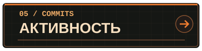</a>
<a href="#контакты">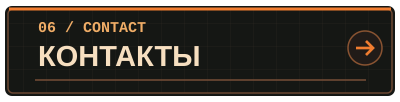</a>

<!-- Принципы Engineering Rules удалены в обновленной иллюстрации ниже -->

<a href="https://github.com/SuiQRim/BillOfSaleSolution">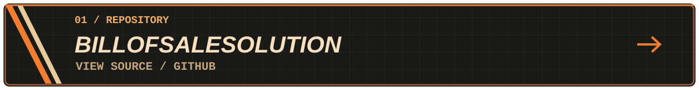</a>

<a href="https://github.com/SuiQRim/Journey">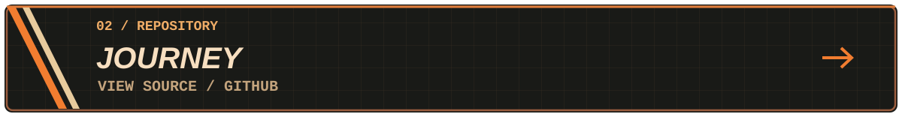</a>

<a href="https://github.com/SuiQRim/Cafeteria.API">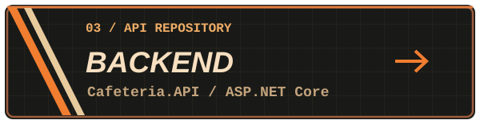</a><a href="https://github.com/SuiQRim/cafeteria_website">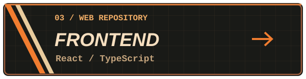</a>

<a href="https://github.com/SuiQRim/SnakeGame">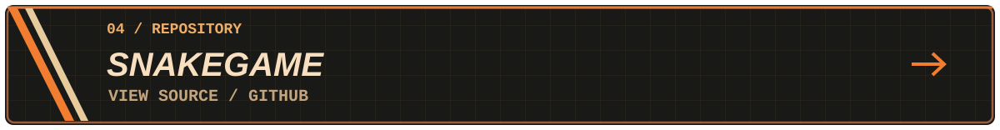</a>

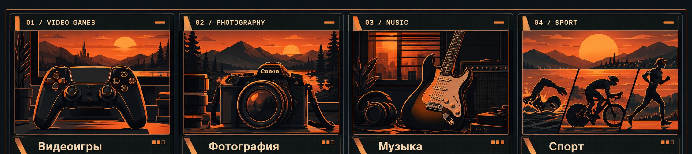

<table>
<tr>
<td width="33%"></td>
<td width="33%"></td>
<td width="33%"></td>
</tr>
</table>
