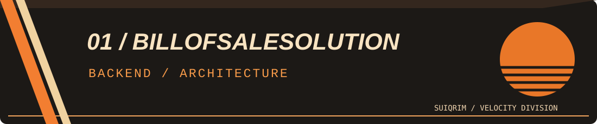
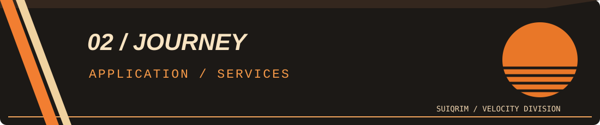
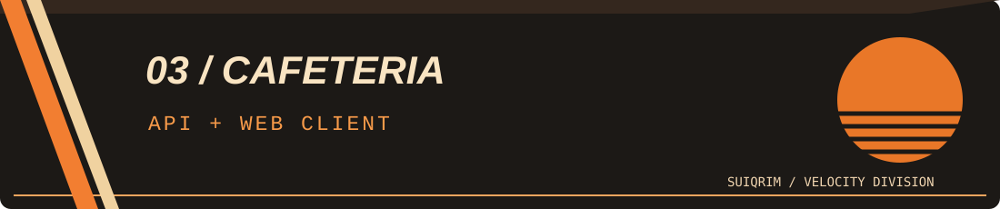
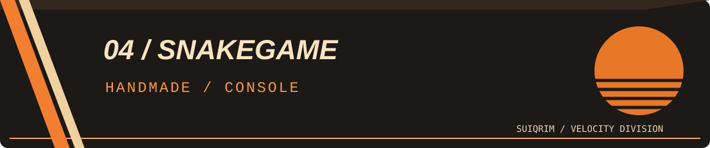
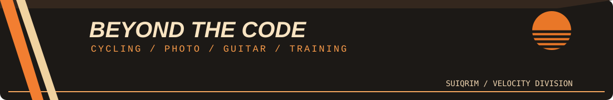

<div align="center">
  
</div>

<div align="center">
  <p><strong>C# / .NET DEVELOPER</strong> &nbsp;·&nbsp; SOFTWARE ENGINEER</p>
  <p><em>Создавать полезное. Проектировать с умом. Не останавливаться.</em></p>
  <p>
    <a href="#обо-мне">Обо мне</a> &nbsp; / &nbsp;
    <a href="#стек">Стек</a> &nbsp; / &nbsp;
    <a href="#проекты">Проекты</a> &nbsp; / &nbsp;
    <a href="#вне-кода">Вне кода</a> &nbsp; / &nbsp;
    <a href="#github-телеметрия">GitHub</a> &nbsp; / &nbsp;
    <a href="#контакты">Контакты</a>
  </p>
</div>

<div align="center">
  
</div>

<a id="обо-мне"></a>


## Обо мне

Привет! Я **Роман Самади** — разработчик, который специализируется на **C# и ASP.NET Core**. Мне нравится создавать программные решения, делающие жизнь людей удобнее. Особенно ценно видеть, как написанный код превращается в продукт, которым действительно пользуются.

Для меня разработка — это не просто задача заставить программу работать. Я стремлюсь создавать решения с **понятной архитектурой, предсказуемым поведением и вниманием к деталям**: такие, которые не стыдно развивать и поддерживать. Интересуюсь проектированием приложений, работой с данными и тестированием.

<div align="center">
  
</div>

<a id="стек"></a>


## Стек

| Направление | Технологии |
| :--- | :--- |
| **Основной язык и платформа** | `C#` · `.NET` · `ASP.NET Core` |
| **Базы данных** | `SQL` · `PostgreSQL` · `MS SQL Server` · `MySQL` |
| **Доступ к данным** | `Entity Framework Core` · `LINQ` |
| **Подходы и практики** | `REST API` · `Dependency Injection` · `Layered Architecture` · `Repository` · `Unit of Work` |
| **Применял в проектах** | `xUnit` · `Moq` · `FluentValidation` · `AutoMapper` · `Docker` · `Git` |
| **Дополнительный опыт** | `WinForms` · `WPF` · `React` · `TypeScript` · `JavaScript` |

**Мой главный фокус — backend на .NET.** Наиболее уверенно чувствую себя с C#, ASP.NET Core, SQL и Entity Framework Core. Остальное — инструменты, которые осваиваю и использую под задачи конкретного проекта.

<details>
<summary><b>/// TECH NOTES — что для меня важно в разработке</b></summary>
<br />

- Разделять ответственность между слоями приложения.
- Делать интерфейсы и контракты понятными для следующего разработчика.
- Проверять не только успешные сценарии, но и ошибки, валидацию и границы данных.
- Избегать сложности ради сложности: архитектура должна помогать продукту.

</details>

<a id="проекты"></a>


## Проекты

**Четыре разные стороны моего опыта:** от архитектурного backend до старой консольной игры, которую написал полностью самостоятельно.

<table>
  <tr>
    <td width="50%" valign="top">
      <a href="https://github.com/SuiQRim/BillOfSaleSolution"></a>
      <h3>01 / BillOfSaleSolution</h3>
      <p><b>Основной архитектурный проект.</b> REST API для работы с актами приёма-передачи товаров. Слои API/BLL/DAL, репозитории, Unit of Work, EF Core и PostgreSQL. Реализованы валидация, Excel-экспорт, модульные и интеграционные тесты.</p>
      <p><code>C#</code> <code>ASP.NET Core</code> <code>EF Core</code> <code>PostgreSQL</code> <code>Tests</code></p>
      <a href="https://github.com/SuiQRim/BillOfSaleSolution"><b>VIEW SOURCE / GITHUB</b></a>
    </td>
    <td width="50%" valign="top">
      <a href="https://github.com/SuiQRim/Journey"></a>
      <h3>02 / Journey</h3>
      <p><b>От интерфейса к архитектуре.</b> Приложение для учёта туристических поездок: WinForms, самостоятельный сервисный слой, разные реализации хранилища, EF Core, асинхронные операции, статистика, логирование, модульные тесты.</p>
      <p><code>C#</code> <code>WinForms</code> <code>EF Core</code> <code>xUnit</code> <code>Moq</code></p>
      <a href="https://github.com/SuiQRim/Journey"><b>VIEW SOURCE / GITHUB</b></a>
    </td>
  </tr>
  <tr>
    <td width="50%" valign="top">
      <a href="https://github.com/SuiQRim/Cafeteria.API"></a>
      <h3>03 / Cafeteria</h3>
      <p><b>Мой более ранний full-stack опыт.</b> Связка ASP.NET Core REST API и React-клиента на TypeScript для каталога блюд. В API есть JWT-аутентификация и работа с данными; клиент использует Axios для запросов.</p>
      <p><code>ASP.NET Core</code> <code>JWT</code> <code>React</code> <code>TypeScript</code></p>
      <a href="https://github.com/SuiQRim/Cafeteria.API"><b>BACKEND</b></a> &nbsp; / &nbsp; <a href="https://github.com/SuiQRim/cafeteria_website"><b>FRONTEND</b></a>
    </td>
    <td width="50%" valign="top">
      <a href="https://github.com/SuiQRim/SnakeGame"></a>
      <h3>04 / SnakeGame</h3>
      <p><b>Old school. Handmade.</b> Моя консольная «Змейка» на C#: игровое поле, меню, управление, движение и рост змейки, локальное хранение результатов. Старый проект, написанный вручную, задолго до AI-ассистентов.</p>
      <p><code>C#</code> <code>Console</code> <code>Game Logic</code></p>
      <a href="https://github.com/SuiQRim/SnakeGame"><b>VIEW SOURCE / GITHUB</b></a>
    </td>
  </tr>
</table>

<details>
<summary><b>/// PROJECT ARCHIVE — почему я показываю и старые работы?</b></summary>
<br />

Каждый проект отражает свой этап обучения: от самостоятельно написанной консольной игры до работы с многослойной архитектурой, БД и тестированием. Для меня это не только набор готовых репозиториев, но и история того, как менялось моё инженерное мышление.

[Все мои репозитории →](https://github.com/SuiQRim?tab=repositories)

</details>

<a id="вне-кода"></a>


## Вне кода

<div align="center">
  
</div>

Люблю занятия, в которых ценятся **выдержка, практика, любопытство и внимание к деталям**. Велосипед даёт чувство свободы, фотография учит замечать свет и композицию, гитара — слышать нюансы, а спорт — работать над собой последовательно.

<details>
<summary><b>/// SECRET COMPARTMENT — личное дело пилота</b></summary>
<br />

```text
VELOCITY DIVISION // PERSONAL DATA
─────────────────────────────────────
FAVORITE COLOR  : ORANGE
DESIGN DNA      : 1970s / RETRO FUTURE
FASCINATION     : MUSCLE CARS / ANALOG TECH
AFTER HOURS     : CYCLING / PHOTOGRAPHY
                  ELECTRIC GUITAR / TRAINING
SYSTEM STATUS   : KEEP EXPLORING
```

Мне нравится эстетика 70-х: американские маслкары, расклёшенные брюки, тёплые оттенки и тот особенный оптимизм, с которым тогда представляли будущее технологий.

</details>

<details>
<summary><b>/// SNAKE.EXE — скрытый запуск</b></summary>
<br />

```text
┌──────────────────────────────────────┐
│   SNAKE.EXE                1 PLAYER  │
│                                      │
│  ██ ██ ██ ●                  ◆       │
│                                      │
│  SCORE: 00070       MODE: CLASSIC    │
└──────────────────────────────────────┘
```

[Открыть исходники моей консольной змейки](https://github.com/SuiQRim/SnakeGame)

</details>

<a id="github-телеметрия"></a>


## GitHub / телеметрия

<div align="center">
  
</div>

<p align="center"><b>CONTRIBUTION DRIVE //</b> каждый коммит — ещё один километр пути.</p>

<div align="center">
  
</div>

<details>
<summary><b>/// SYSTEM INFO — как работает змейка?</b></summary>
<br />

Изображение выше генерируется GitHub Actions из моей публичной активности. Оно обновляется автоматически и **не связано** с отдельной консольной игрой [SnakeGame](https://github.com/SuiQRim/SnakeGame). После создания репозитория профиля анимация появится после первого успешного запуска workflow.

</details>

<a id="контакты"></a>


## Контакты

<div align="center">
  <a href="mailto:samadio.roman@gmail.com"><b>EMAIL</b></a>
  &nbsp; / &nbsp;
  <a href="https://t.me/suiqrim"><b>TELEGRAM</b></a>
  &nbsp; / &nbsp;
  <a href="https://github.com/SuiQRim"><b>GITHUB</b></a>
  &nbsp; / &nbsp;
  <a href="https://steamcommunity.com/id/SuiQRim/"><b>STEAM</b></a>
</div>

<p align="center"><em>Открыт к интересным задачам, новым технологиям и профессиональному общению.</em></p>

<div align="center">
  
</div>
